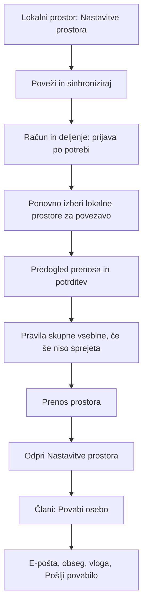
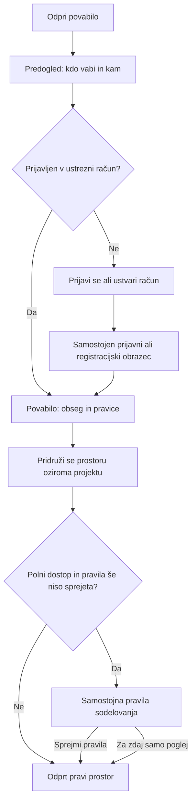

# Analiza prve prijave iz povabila in deljenja prostorov

Datum: 16. oktober 2026; dopolnjeno po opisu dejanskega prvega vstopa. Ta dokument je zgodovinski zapis analize pred izvedbo. Po naknadnem izrecnem uporabnikovem naročilu je prenova izvedena v lokalnem izvoru; aktualni obseg, testi in meje so v [zapisu izvedbe](INVITATION_AND_SHARING_IMPLEMENTATION.md). Opisi »sedanjega toka« spodaj pomenijo stanje ob analizi. Trgovinska izdaja in nadgradnja gostovanj nista izvedeni.

## 1. Glavna ugotovitev

Težava ni samo dolžina besedil. Uporabnik želi opraviti eno nalogo — pridružiti se povabljenemu prostoru oziroma povabiti drugo osebo — vmesnik pa od njega zahteva razumevanje računa, strežnika, lokalnega prostora, sinhronizacije, članstva in pravil skupne vsebine.

Predlagam dve povezani spremembi:

- **Prejemnik dobi namenski tok povabila:** povabilo → prijava ali ustvarjanje računa, če je potrebno → izrecna pridružitev → povabljeni prostor. Splošne nastavitve računa niso vmesni cilj.
- **Pošiljatelj začne pri prostoru z dejanjem »Deli prostor«:** ista pot ga po potrebi vodi skozi prijavo, pravila in prenos izbranega lokalnega prostora ter se nadaljuje s povabilom. Ni mu treba iskati naslednjega koraka drugje.

Dopolnitev: **namestitev je del prvega vstopa**, zato se vodenje začne že na spletni strani povabila. **Izrecna uporabnikova zahteva:** ustvarjanje novega gospodinjstva in nove organizacije mora že v začetnem obrazcu ponuditi možnost **»Sinhroniziraj z oblakom«**. Tako lahko uporabnik prostor pripravi za uporabo na svojih napravah in poznejše deljenje že ob nastanku, brez naknadnega obiska nastavitev prostora.

**Pravila sodelovanja naj imajo samostojen zaslon.** Ne sodijo med polja prijave, registracije ali pošiljanja povabila. Sprejem pravil in pridružitev prostoru ostaneta različni odločitvi. Ključni podatki o dostopu — zlasti finance, prihodnji projekti ter pravica do brisanja in vabljenja drugih — ostanejo vidni neposredno pred pridružitvijo oziroma pošiljanjem povabila.

Ločeni zasloni zato niso nujno več dela: vsak zaslon ima eno nalogo, aplikacija pa sama ohrani razlog, zaradi katerega ga je odprla.

## 2. Kaj je bilo pregledano in kaj ni dokazano

Analiza temelji na lokalni kodi Flutter, slovenskih besedilih, izvoru FamilyHub, pogodbah API in obstoječih testnih scenarijih. Prvotni pregled je imel Git HEAD `fb9415f` in druge lokalne spremembe. Dopolnilni pregled prvega zagona in ustvarjanja prostorov je opravljen pri `40cdb5f`; ob začetku sta bili neversionirani le ta analiza in ločeni varnostni pregled. Ugotovitve opisujejo pregledani izvor, **ne potrjene vsebine uporabnikove nameščene aplikacije ali trenutnega živega strežnika**.

V tem koraku ni bilo prijavljanja v račune, pošiljanja povabil, registracij, sprejemanja pravil, poseganja v podatke, gradnje aplikacije ali trgovinske oddaje. Obstoječi testi so bili prebrani, niso bili ponovno zagnani. Naknadno je bil vizualno pregledan uporabnikov posnetek `1000012037.jpg`; aplikacija ni bila preizkušena v živo in tok na prejemnikovem telefonu ni bil ponovljen.

Uporabnik je naknadno opisal konkretni primer: kot že prijavljen lastnik je ustvaril prostor in poslal povabilo osebi, ki **ni imela niti aplikacije niti računa na tem strežniku**. Povabilo ji ni jasno razložilo namestitve in vrnitve na povezavo; težave je imela tudi po namestitvi in odpiranju aplikacije. To je uporabnikovo poročilo o resnični uporabi. Točen zadnji prikaz, različica aplikacije in morebitna napaka niso znani, zato ne trdimo, da smo ponovili isti zastoj. Prejšnje odpravljene napake povabil iz 10. oktobra niso dokaz, da se ista napaka ponavlja danes.

## 3. Sedanji tok prejemnika

### 3.1 Nov uporabnik z že nameščeno aplikacijo

Ob uspešni običajni poti iz e-pošte se zgodi naslednje:

1. Odpre povezavo v e-pošti. Sporočilo navede povabitelja, ime prostora in vlogo.
2. Odpre se spletna stran »Povabilo v prostor«. Pokaže strežnik in tri možnosti: »Odpri v aplikaciji«, »Kopiraj povezavo« in »Kopiraj kodo povabila«.
3. Po izbiri odpiranja aplikacije Jivie prikaže še dialog »Odpri povabilo« z opozorilom o strežniku in gumbom »Nadaljuj do povabila«.
4. Odpre se **»Račun in deljenje«**, izbran je »Imam povabilo«. Strežnik in koda sta iz povezave že izpolnjena, vendar prikazana kot polji. Uporabnik mora pritisniti **»Preveri povabilo«**.
5. V istem obrazcu se pokažejo podatki povabila, daljša pojasnila dostopa in izbira »Ustvari račun« / »Že imam račun«. Pri javnem predogledu e-poštnega povabila je ustvarjanje računa privzeto izbrano.
6. Nov uporabnik vpiše **uporabniško ime, ime za prikaz, geslo in ponovitev gesla**. Vidne so še »Dodatne možnosti prijave« z imenom naprave. Pritisne »Ustvari račun«.
7. Registracija ustvari račun in sejo; uporabnik je že prijavljen. Nato na zaslonu računa poišče kartico **»Povabilo čaka na tvojo odločitev«** in pritisne »Sprejmi povabilo«.
8. Aplikacija sprejme članstvo, izbere pravi prostor in odpre njegov Utrip.

To pomeni najmanj **šest glavnih pritiskov od povezave v pošti do sprejema**, brez vnosov, premikanja med polji, morebitnega drsenja in sistemskih vprašanj brskalnika. To je štetje poti iz kode, ne meritev na telefonu.

Pomembno: uspešna registracija iz e-poštnega povabila **že potrdi njegov e-poštni naslov** in vrne prijavo. Ločena potrditvena pošta ter ponovna ročna prijava pri običajnem uspehu nista zahtevani. Ločen ostane sprejem članstva. Tega ob prenovi ne smemo po nepotrebnem podaljšati.

Viri: [e-pošta](../server/plugins/FamilyHub/Model/NativeAccountMailTransport.php), [spletna stran povabila](../server/plugins/FamilyHub/Controller/InvitationController.php), [prehod v aplikaciji](../lib/organizer/presentation/organizer_shell.dart#L250), [prijavni obrazec](../lib/organizer/presentation/shared/sharing_auth.dart), [čakajoča povabila](../lib/organizer/presentation/shared/sharing_pending_invitations.dart), [registracija na strežniku](../server/plugins/FamilyHub/Model/NativeEmailInvitationService.php#L94).

### 3.2 Uporabnik z obstoječim računom

Odjavljen uporabnik opravi enak začetni del. Po predogledu mora dodatno izbrati »Že imam račun«, nato vpisati **uporabniško ime in geslo**, po potrebi še TOTP. E-poštni naslov, na katerega je prejel povabilo, trenutno ni prijavni identifikator: strežnik pri prijavi išče `username`.

Javni predogled namerno ne razkrije, ali račun za e-poštni naslov obstaja. Zato `registrationAllowed: true` ni dokaz, da je prejemnik nov. Privzeto izbrana registracija lahko obstoječega uporabnika usmeri v napačen postopek; napako dobi šele po poskusu ustvarjanja računa.

Če je uporabnik **že prijavljen na istem strežniku**, aplikacija po uvodnem dialogu pokaže čakajoče povabilo brez novega prijavnega obrazca. Čakajoča povabila za potrjeni e-poštni naslov lahko najde tudi brez lepljenja kode. Te dobre lastnosti je treba ohraniti.

Viri: [izbira avtentikacije](../lib/organizer/presentation/shared/sharing_account_page.dart#L201), [prijava po uporabniškem imenu](../server/plugins/FamilyHub/Model/NativeAuthService.php#L64), [pogodba povabil](server/email-invitation-api-contract.md).

### 3.3 Uporabnik brez aplikacije in ročno lepljenje povezave

Spletna stran povabila nima gumba za namestitev aplikacije ali jasne poti »namesti in se vrni sem«. Uporablja povezavo `jivie://`; pregledana mobilna konfiguracija vsebuje lastno URL shemo. Iz tega ni mogoče obljubiti samodejnega nadaljevanja povabila po novi namestitvi.

Ročni rezervni tok je tudi nedosleden:

- Odjavljeni obrazec zna iz prilepljene povezave `jivie://` razbrati strežnik in kodo, čeprav polje in navodilo omenjata samo kodo.
- Dialog »Imam povabilo« za prijavljenega uporabnika vrednost pošlje neposredno kot token in je ne razčleni kot povezavo. Kopirana aplikacijska povezava zato po pregledani poti ne prestane preverjanja formata kode.
- Izvirna povezava HTTPS iz e-pošte ni podprta v istem razčlenjevalniku kot `jivie://`. Uporabnik lahko torej kopira povsem pravo povezavo na mestu, kjer aplikacija pričakuje drug format.

To je konkretna nedoslednost iz kode, primerna za poznejši ciljni preizkus. Ni dokaz, da je bila vzrok zadnje prijavljene težave.

Viri: [razčlenjevalnik](../lib/organizer/platform/invitation_links/invitation_link.dart), [odjavljeni obrazec](../lib/organizer/presentation/shared/sharing_auth.dart#L73), [prijavljeni dialog](../lib/organizer/presentation/shared/sharing_accept.dart#L11), [preverjanje tokena](../lib/organizer/data/collaboration_email_invitations.dart#L19), [Android](../android/app/src/main/AndroidManifest.xml), [iOS](../ios/Runner/Info.plist).

### 3.4 Prvi zagon po namestitvi

Sedanji začetni prikaz je Utrip. Na osebnem prostoru ponuja začetni namig, splošni vodič s petimi stranmi in izbiro »Kako želiš začeti?«. Ta izbira vsebuje »Samo na tej napravi«, »Poveži moje naprave« in »Skupni dom«; **nima neposrednega »Imam povabilo«**. Splošni vodič razlaga dele aplikacije, ne izvede registracije in sprejema povabila. Gre za možnost, ki jo uporabnik odpre, ne za dokaz obveznih petih zaslonov ob vsakem zagonu.

Ko aplikacija prejme povezavo, jo koordinator shrani in jo zna po ponovnem zagonu obnoviti. Toda aplikacija, ki pred namestitvijo ni mogla prejeti povezave, ob odpiranju svoje ikone iz tega mehanizma ne izve, katero povabilo je bilo prej odprto v brskalniku. **Shranjevanje že prejetega povabila in nadaljevanje po prvi namestitvi sta različni stvari.**

Ta vrzel ustreza opisanemu zaporedju uporabnika, ni pa dokaz, da se je zgodila prav na njegovem telefonu. Že jasno navodilo »Po namestitvi ponovno odpri povabilo iz e-pošte« bi odstranilo pomemben del ugibanja.

Predlog za prvi zagon:

- Če je povabilo že prejeto/shranjeno, neposredno odpri njegov čarovnik; splošni ogled aplikacije lahko počaka.
- Če povabila ni, vidno ponudi **»Imam povabilo«**, ob njem »Začni brez računa« in »Že imam račun«. Povabljenemu uporabniku ni treba ustvarjati svojega Doma.
- »Imam povabilo« pove »Vrni se v e-pošto in odpri povabilo« ter ponudi ročno lepljenje povezave kot rezervno možnost. Samodejnega pregledovanja odložišča ni treba uvajati.
- Če uporabnik čarovnik zapre, naj ostane opazen »Nadaljuj povabilo v Dom«. Navadno lokalno delo ostane dosegljivo.

Viri: [začetna navigacija](../lib/organizer/presentation/navigation/organizer_navigation.dart#L70), [začetne izbire](../lib/organizer/presentation/onboarding/getting_started.dart#L50), [splošni vodič](../lib/organizer/presentation/onboarding/first_time_guide.dart#L56), [hramba in obnova povezave](../lib/organizer/platform/invitation_links/invitation_link_coordinator.dart#L33).

## 4. Sedanji tok pošiljatelja

### 4.1 Prostor je že povezan

Lastnik oziroma upravičeni član izbere prostor, odpre **Nastavitve prostora → Člani → Povabi osebo**. Na telefonu sta »Račun in deljenje« in »Nastavitve prostora« dosegljiva tudi kot ločena cilja v »Več«.

Obrazec za povabilo vsebuje:

- obseg: cel prostor ali izbrani projekt;
- e-poštni naslov;
- vlogo: »Član« ali »Bere«;
- pojasnilo obsega in pravic;
- »Pošlji povabilo«.

To je že smiselna osnova: pošiljatelj ne ustvarja prejemnikovega računa in ne izbira njegovega gesla. Vendar je dejanje skrito za nastavitvami, obrazec pa vključuje veliko razlag in tehnični izraz »Obseg povabila«.

Če pravila skupne vsebine še niso sprejeta, lahko po poskusu pošiljanja vmes poseže dialog pravil. Splošni obrazec po sprejemu pravil prikaže »Pravila so sprejeta. Ponovno shranite za pošiljanje te spremembe.« Uporabnik mora dejanje ponoviti. Ta vmesni korak je pogojen; ni del vsakega povabila.

### 4.2 Prostor je še lokalen

Pot je daljša in razpršena:



Klik »Poveži in sinhroniziraj« iz lokalnega prostora odpre račun brez namenskega nadaljevanja povabila ali vnaprej izbranega prostora v povezovalnem panelu. Panel nato ponuja seznam lokalnih prostorov. Po prenosu ni neposrednega nadaljevanja v »Povabi osebo«.

Ločen predogled prenosa ima pomemben namen: prijava sama ne sme objaviti lokalne vsebine. **Ohraniti je treba odločitev o prenosu, odpraviti pa ročno iskanje in ponovno izbiranje.**

#### Konkretna potrditev s posnetkom uporabnika

Uporabnik je poslal posnetek `1000012037.jpg` in pojasnil, da je pred tem v nastavitvah izbranega prostora že pritisnil »Poveži in sinhroniziraj«. Posnetek pokaže:

- V zgornjem izboru je **»nova organizacija«**.
- Pod kartico **»Moje naprave«** je kartica **»Poveži in sinhroniziraj«**.
- Ista **»nova organizacija«** je v njej znova ponujena z neoznačenim potrditvenim poljem.
- Ponovljeni gumb **»Poveži in sinhroniziraj«** je zato onemogočen.

To je neposreden vizualni dokaz odvečne ponovne izbire. Predhodni klik je opisan s strani uporabnika, pripadajoča pot pa je preverjena v kodi: `LocalSpaceSettings.onConnect` prek lupine samo odpre splošno stran računa; `LocalSpaceConnectionPanel` začne z lastnim praznim izborom. Kontekst konkretnega ukaza se ne prenese v povezovalni postopek.

Kartica »Moje naprave« dodatno meša pomen: zeleni oblak in »Začasno ustavi sinhronizacijo« se nanašata na zasebni osebni prostor, medtem ko glava prikazuje organizacijo. Besedilo »Vanjo ni mogoče povabiti drugih oseb« lahko uporabnik pripiše pravkar izbrani organizaciji. Posnetek zato ne dokazuje, da je organizacija že sinhronizirana; pokaže, zakaj lahko uporabnik tako razume zaslon.

**Zahteva za prenovo:** pri vstopu iz konkretnega prostora ta vmesni izbor v celoti odpade. Samodejna označitev kljukice na istem zaslonu bi rešila en pritisk, pustila pa bi odvečen zaslon, podvojeni gumb in nepovezano kartico zasebne sinhronizacije.

Viri: [gumb v lokalnih nastavitvah](../lib/organizer/presentation/shared/local_space_settings.dart#L89), [prehod samo na račun](../lib/organizer/presentation/organizer_shell.dart#L2271), [ločeni izbor in onemogočeni gumb](../lib/organizer/presentation/onboarding/local_space_connection_panel.dart#L145).

### 4.3 Deljenje projekta in skupna kopija

V aplikaciji obstajajo različna dejanja s sorodnim namenom:

| Dejanje | Kaj dejansko naredi |
| --- | --- |
| Poveži in sinhroniziraj | Poveže obstoječi lokalni prostor in prenese predogledano vsebino. |
| Povabi osebo | Omogoči članstvo v že povezanem prostoru ali projektu po sprejemu prejemnika. |
| Ustvari skupno kopijo | Kopira osebni projekt/seznam; nadaljnje spremembe izvirnika se ne prenašajo. Ta pot ne prenese njegovih financ in dogodkov. |
| Ločitev starega projekta / prehod pravil dostopa | Poseben postopek za stare strukture in širitev dostopa; potrebuje svoj predogled. |

Eno poimenovanje »Deli« ne sme prikriti razlike med živo povezavo in neodvisno kopijo. Lahko pa postane skupna vstopna točka, ki za konkretno vsebino jasno pojasni ustrezno dejanje. Starega projekta z neločljivimi odvisnostmi ne smemo tiho nadomestiti s povabilom v cel prostor.

Viri: [navigacija](../lib/organizer/presentation/organizer_shell.dart#L2271), [lokalne nastavitve](../lib/organizer/presentation/shared/local_space_settings.dart), [povezava prostora](../lib/organizer/presentation/onboarding/local_space_connection_panel.dart), [člani in pošiljanje](../lib/organizer/presentation/shared/sharing_members.dart#L155), [splošni obrazec](../lib/organizer/presentation/shared/sharing_forms.dart#L145), [skupna kopija](../lib/organizer/presentation/shared/sharing_copy.dart), [ločitev projekta](../lib/organizer/presentation/shared/project_sharing_settings.dart).

## 5. Ugotovitve po pomembnosti

Prioritete označujejo pričakovani vpliv na razumljivost, ne izmerjene stopnje opuščanja.

| Prioriteta | Ugotovitev iz kode | Zakaj je to ovira | Predlagana smer |
| --- | --- | --- | --- |
| Visoka | Povabilo vodi na »Račun in deljenje«. Po prijavi so poleg povabila še zasebna sinhronizacija, povezovanje lokalnih prostorov, e-pošta in izbris računa. | Ni jasno, ali je prvi vstop že končan in kaj je naslednji korak. | Namenski tok povabila; račun ostane ločen cilj. |
| Visoka | Odjava/prva prijava iz povezave še vedno zahtevata »Preveri povabilo« in kažeta strežnik ter kodo. | Uporabnik potrjuje tehnične podatke, ki jih je aplikacija že dobila. | Samodejni predogled v dovoljenem kontekstu; strežnik kot informacija, koda samo v rezervni poti. |
| Visoka | Povezava lokalnega prostora in pošiljanje povabila sta na različnih mestih. | Lastnik mora sam sestaviti postopek in ponovno izbrati cilj. | »Deli prostor« ohrani izbrani prostor in nadaljuje do povabila. |
| Visoka | Povabilo po e-pošti zahteva poznavanje uporabniškega imena; registracija zahteva štiri vnose brez sprotne razlage vseh omejitev. | E-pošta in uporabniško ime delujeta kot dve nepovezani identiteti. Napake lahko pridejo šele ob oddaji. | Jasna razlaga prijave, sprotna validacija in predlog uporabniškega imena; e-poštna prijava je ločena strežniška nadgradnja. |
| Visoka | »Pozabljeno geslo« je v `SharingAuthPanel` prikazano samo zunaj načina povabila. | Prav pri prejemniku z obstoječim računom manjka izhod iz pogoste težave. | Obnova gesla znotraj toka, nato vrnitev na isto povabilo. |
| Visoka | »Kopiraj povezavo« in oba načina ročnega sprejema ne podpirajo enakih formatov. | Navodilo lahko uporabnika pripelje do zavrnitve veljavne povezave. | Enotna podpora dovoljeni povezavi HTTPS, aplikacijski povezavi in kodi. |
| Srednja | Obrazec privzeto izbere registracijo tudi za morebitnega obstoječega uporabnika. | Uporabnik lahko izpolni napačen obrazec. | Dve jasni izbiri pred prikazom polj; brez ugibanja obstoja računa. |
| Srednja | Isti dolgi opis povabila se pojavi pred prijavo in po njej; govori o »povabljeni osebi«. | Ponavljanje in govor v tretji osebi otežita razumevanje lastnega dejanja. | Pred prijavo kratek kontekst; pred pridružitvijo točen povzetek v drugi osebi. |
| Srednja | Pravila so ločen modalni dialog, vendar se lahko odprejo nad obrazcem in zahtevajo ponovitev oddaje. | Občutek nove ovire sredi že izpolnjenega postopka. | Namenski korak z vrnitvijo na ohranjen osnutek in jasnim nadaljevanjem. |
| Srednja | »Član« ima tudi pravice brisanja, financ in vabljenja; »Bere« je drugačen slog poimenovanja, pošta uporablja »Ogledovalec«. | Ime vloge ne pove njene širine. | Dosledno »Polni dostop« / »Samo ogled« z neposrednim kratkim opisom. |
| Srednja | Povabilo privzeto velja 24 ur; UI rok formatira samo kot datum, pošta roka ne navede. | »Velja do jutri« lahko uporabnik razume kot konec naslednjega dne. | Datum in ura s časovnim pasom oziroma jasnim lokalnim časom, tudi v pošti. |
| Srednja | Seznam poslanih povabil ima preklic, nima neposrednega »Pošlji znova«; pošiljanje potrdi uvrstitev v vrsto. | Lastnik težko pomaga prejemniku in lahko zamenja pripravljeno pošto za dostavljeno. | Dejanja in razumljiva stanja na istem mestu; dokaz dostave ostane ločen. |
| Srednja | Nekateri različni vzroki zavrnitve uporabljajo isto `invitation_invalid` in splošno sporočilo. | Uporabnik ne ve, ali naj zamenja račun ali prosi za novo povabilo. | Ponudi varne naslednje korake; natančen razlog pokaži le, če je dejansko znan. |

Dodatni vir za obrazec: strežnik omeji uporabniško ime na 3–64 znakov iz `a–z`, številk, `_`, `.` in `-`; geslo na 12–72 bajtov UTF-8. Obrazec povabila preveri obveznost in ujemanje gesel, teh omejitev pa ne predstavi ali sproti preveri. Obstoječa pot »Prvi račun s kodo« že uporablja strožji validator gesla. Prenova mora uskladiti prikaz z dejansko pogodbo, ne zgolj preimenovati bajtov v znake.

Viri: [računska stran](../lib/organizer/presentation/shared/sharing_account_page.dart#L316), [obrazec](../lib/organizer/presentation/shared/sharing_auth.dart#L463), [prikaz povabila](../lib/organizer/presentation/shared/sharing_invitation_details.dart), [validacija strežnika](../server/plugins/FamilyHub/Model/NativeDatabase.php#L250), [geslo in rok](../server/plugins/FamilyHub/Model/NativeEmailInvitationService.php#L74), [validator obnove/začetnega računa](../lib/organizer/presentation/onboarding/account_recovery_actions.dart#L11), [format datuma](../lib/organizer/presentation/organizer_widgets.dart#L8), [napake](../lib/organizer/presentation/shared/sharing_errors.dart).

## 6. Predlagani tok prejemnika

### 6.1 Namenski čarovnik in vrstni red

Uporabnikov predlog **»ustvari račun → sprejmi povabilo → strinjam se z deljenjem«** je smiseln kot voden postopek. Popravil bi pomen zadnjega koraka: razlago, **kaj se deli in kakšne pravice dobiš**, mora uporabnik videti pred pridružitvijo. Po uspešni pridružitvi ni smiselno še enkrat zahtevati soglasja za isto članstvo. Če zadnji korak pomeni pravila ravnanja pri skupnem delu, naj se imenuje »Pravila sodelovanja«.

Priporočeni vrstni red za novega uporabnika je **račun → povabilo in pridružitev → pravila sodelovanja, če so potrebna → prostor**. To je dopolnitev prvotnega predloga: članu s polnim dostopom lahko pravila ponudimo že na koncu čarovnika, da ga ne presenetijo ob prvem opravilu. Ker obstoječa pogodba dopušča branje brez sprejema pravil, ostane tudi »Za zdaj samo poglej«. Pri uporabniku za ogled oziroma že sprejetih pravilih se ta korak izpusti. Ob prvem dejanju, ki pravila zahteva, se morebitni odloženi korak odpre posebej.



**Prvi zaslon: »Povabilo v Dom«**

Pokaže povabitelja, ime prostora/projekta in strežniško domeno. Če prijava manjka, ponudi »Ustvari račun« in »Že imam račun«. Brez polj za kodo in strežnik ter brez naprednih nastavitev. Gumba tukaj samo izbereta naslednji korak, ne sprejmeta članstva.

Pri znanem, že zaupanem strežniku naj se predogled naloži brez dodatnega »Preveri povabilo«. Pri novem ali drugačnem strežniku mora biti izvor jasen **pred pošiljanjem kode ali poverilnic**; po potrebi ostane kratek korak »Nadaljuj na [domena]«. Odprava odvečnih klikov ne pomeni tihe menjave strežnika ali pošiljanja obstoječega gesla drugemu izvoru.

**Drugi zaslon: samo prijava oziroma samo registracija**

Na vrhu ostane kratek kontekst »Nadaljuješ povabilo v Dom«. Prijava pokaže uporabniško ime, geslo in »Pozabljeno geslo?«; TOTP se pokaže, ko ga strežnik zahteva. Obnova gesla se vrne na isto povabilo. Pot »Prvi račun s kodo« sodi v napredno nastavitev lastnega strežnika, ne med običajne korake povabljenega uporabnika.

V prvi izvedbeni fazi priporočam ohranitev sedanjega modela računa, vendar z razlago in validacijo polj pred oddajo. Kot nadaljnjo poenostavitev je smiselno preveriti predlagano, uredljivo uporabniško ime, privzeto ime za prikaz ter eno geslo z možnostjo prikaza. To zahteva premišljeno ravnanje z zasedenim imenom in upravljalniki gesel. Ne obljubljamo dvopoljne registracije, dokler niso ta pravila dogovorjena.

E-poštni naslov iz povabila je samo prikazan; novi uporabnik ga ne vpisuje znova in ga po uspešni registraciji iz tega povabila ne potrjuje še enkrat.

**Tretji zaslon: izrecna pridružitev**

Po uspešni prijavi se tok samodejno vrne k povabilu. Primer za novejši model deljenja:

```text
Pridruži se prostoru Dom
Povabil te je Anže.

Dostop: cel prostor
Vse skupne vsebine in finance ter sedanji in prihodnji projekti.

Pravice: polni dostop
Lahko dodajaš, urejaš in brišeš vsebino ter finance,
spreminjaš nastavitve in vabiš ali odstranjuješ člane.
Lastništvo ostane zaščiteno.

Tvoj osebni prostor ostane zaseben.
Prijavljen račun: [uporabniško ime] · [e-pošta]
Strežnik: [domena]

[Pozneje]                         [Pridruži se prostoru]
```

Za projekt: »Pridruži se projektu Prenova«, »Samo ta projekt in njegove finance«. Za bralca: »Samo ogled« in »Lahko bereš vsebino in finance. Spreminjanje in upravljanje nista omogočena.« Podatek o osebnem prostoru se nanaša na osebne podatke; ne sme zmanjšati poudarka, da so finance deljenega prostora vključene.

Po uspehu se pokaže kratko »Pridružil/a si se prostoru Dom«. Če sledi še korak pravil, mora biti jasno, da je članstvo že urejeno. Po sprejemu pravil ali izbiri »Za zdaj samo poglej« se odpre pravi prostor. Kadar pravila niso potrebna, se prostor odpre takoj; dodatnega obveznega gumba »Odpri prostor« ni treba dodajati. Odložitev pravil ne spremeni vloge člana v vlogo bralca; samo skupni zapisi ostanejo vezani na potreben sprejem pravil.

Čarovnik naj ima stalno ime povabljenega prostora, jasen napredek in eno glavno dejanje na zaslon. **En korak pomeni eno nalogo, ne eno polje:** uporabniškega imena in vsakega gesla ni smiselno razbiti na dodatne strani. Že prijavljen uporabnik preskoči registracijo. Vrnitev iz obnove gesla, prekinitev ali ponovni zagon ohranijo smiselno nadaljevanje. Na namizju je to lahko en namenski modalni tok z notranjimi koraki; na telefonu cel zaslon.

»Pozneje« ohrani čakajoče povabilo. To ni zavrnitev ali preklic; strežniški postopek zavrnitve povabila v pregledani pogodbi ni predviden.

### 6.2 Namestitev in rezervna pot

Spletna stran naj jasno pokaže obe poti, še preden odpiranje aplikacije odpove:

```text
Povabilo v Jivie

Že imaš aplikacijo?
[Odpri Jivie in nadaljuj]

Še nimaš aplikacije?
1. Namesti Jivie.
2. Vrni se v to e-pošto in ponovno odpri povabilo.

[Namesti Jivie]
```

Gumb v pošti in na spletni strani naj bo »Odpri povabilo«, ne »Sprejmi«, kadar samo odpira naslednji prikaz. S tem uporabniku ne sporočamo, da je članstvo že potrdil. Ni treba čakati, da brskalnik ugotovi odsotnost aplikacije; navodilo za namestitev je lahko vedno jasno vidno. Povezava vodi v dejansko razpoložljivo trgovinsko različico za platformo; ne prikazuje izmišljene razpoložljivosti iOS. Samodejno nadaljevanje po namestitvi je ločena tehnična nadgradnja, ki jo je treba preveriti na napravah. V prvi fazi naj bo ponovna uporaba iste povezave zanesljiva in razumljiva.

»Aplikacija se ne odpre?« razkrije rezervni način. Enotno polje v aplikaciji naj bo **»Prilepi povezavo ali kodo povabila«**. Samo pri goli kodi brez znanega izvora je potreben še naslov strežnika. Razčlenjevanje vseh podprtih formatov mora uporabljati enaka pravila in ne sme samodejno sprejeti članstva.

### 6.3 Stanja, ki jih tok mora jasno obravnavati

| Stanje | Predlagani odziv |
| --- | --- |
| Prijavljen je drug račun | Pokaži račun in naslovnika, kadar sta podatka preverjeno znana; ponudi »Uporabi drug račun«. Povabilo se ohrani. |
| Obstoječi račun nima potrjene ustrezne e-pošte | Usmeri v ločeno pot potrditve naslova z vrnitvijo na povabilo. Ne spreminjaj naslova računa samodejno. |
| Račun že obstaja | »Za ta naslov že obstaja račun. Prijavi se.« Ohranita se povabilo in že izbrano uporabniško ime, kjer je smiselno. |
| Povezava ni več uporabna | »S tem povabilom se trenutno ne moreš pridružiti. Preveri račun ali prosi pošiljatelja za novo povabilo.« Natančneje »poteklo« samo ob znanem razlogu. |
| Ni povezave | »Povabilo je shranjeno. Za nadaljevanje potrebuješ povezavo.« Ponovni poskus ne začne postopka od začetka. |
| Račun nastane, shranitev seje pa ne uspe | »Račun je ustvarjen. Prijavi se za nadaljevanje.« Ne spodbuja ponovne registracije. |
| Sprejem uspe, prenos podatkov pa odpove | Preveri dejansko članstvo in ponudi »Ponovi nalaganje prostora«. Ne trdi, da registracija ali sprejem nista uspela. |
| Prispe drugo povabilo | Uporabnik lahko nadaljuje želenega; pozni odgovor prvega ne sme izbrisati novega. |
| Uporabnik zapre tok ali aplikacijo | Povabilo se ohrani v varni shrambi; gesla se zaradi nadaljevanja ne shranjujejo v navadne osnutke. |

## 7. Predlagani tok pošiljatelja

**Enotna vstopna točka: izbrani prostor → ikona »Deli prostor«.** Pri samostojnem projektu »Deli projekt«. Ikona ob prostoru ima tudi dostopno besedilno oznako oziroma namig. Odpre neposredno obrazec za povabilo z že izbranim ciljem, ne najprej celotne strani nastavitev ali seznama članov. »Člani in povabila« ostane dosegljivo na istem mestu kot sekundarno dejanje; upravljanje članov se ne podvaja po drugih delovnih zaslonih. To upošteva novo uporabnikovo željo po neposredni ikoni.

### Že povezan prostor

```text
Dom → ikona Deli
→ e-pošta + dostop → Pošlji povabilo → seznam članov in povabil
```

Ime cilja je jasno v naslovu. Privzeto je izbran prostor oziroma projekt, iz katerega je uporabnik prišel. Naprednejša izbira drugega obsega je dosegljiva, ni pa nujna za vsak običajni primer. Pri pogledu »Vsi« je treba cilj najprej izrecno izbrati.

Običajni primer mora zahtevati **en vnos in eno pošiljanje**. Obstoječi privzeti polni dostop ostane viden s kratkim opisom, izbira »Samo ogled« je na voljo brez dodatnega obveznega zaslona. »Konec« na strani pošiljatelja pomeni ustvarjeno povabilo; članstvo nastane po odločitvi prejemnika.

Uporabnik predlaga vnos **uporabniškega imena ali e-pošte**. To je smiselna enotna vnosna točka, vendar sedanja nova pogodba sprejema e-pošto. Stari tok na uporabniško ime ni ustrezen nadomestek: politika 3 ga zavrne, njegovo registracijsko vedenje pa je drugačno. Za povabilo po uporabniškem imenu je treba dodati ustrezno strežniško pot do obstoječega računa z enakim ločenim sprejemom in enakimi pravicami. Ne gre samo za preimenovanje polja. Novi uporabnik brez računa je povabljen po e-pošti; ne po imenu, ki naj bi ga šele ustvaril. Če to izvedbo razdelimo na faze, naj polje do dejanske podpore imenu pove jasno »E-poštni naslov«.

Predlagani obrazec:

```text
Povabi v Dom

E-poštni naslov
[                              ]

Dostop
[Polni dostop]  [Samo ogled]

Vključeno: cel prostor, finance in vsi sedanji ter prihodnji projekti.
Polni dostop omogoča tudi brisanje, nastavitve in upravljanje članov.
Lastništvo ostane zaščiteno.

Želiš deliti samo en projekt? [Izberi projekt]

[Prekliči]                           [Pošlji povabilo]
```

Ne dodajamo še ene potrditve z isto vsebino: zgornji povzetek in pošiljanje sta dovolj, kadar se vmes ne spremeni cilj ali obseg. Prejemnik prostor še vedno sprejme sam.

### Lokalni prostor ob prvem deljenju

```text
Dom → Deli prostor
→ prijava, če je potrebna
→ samostojna pravila sodelovanja, če še niso sprejeta
→ predogled prenosa samo izbranega Doma
→ Omogoči deljenje
→ Povabi osebo
```

Tok ohrani točni lokalni prostor, račun in namen »povabi osebo«. Prenos se izvede šele po konkretnem predogledu. Po uspehu se sam odpre povabilo za nastali skupni prostor. Množično povezovanje več prostorov lahko ostane napredna možnost zunaj te običajne poti.

**Če uporabnik začne samo z »Poveži in sinhroniziraj« v nastavitvah konkretnega prostora**, se nadaljuje povezava tega prostora, ne celotni tok vabljenja:

```text
Nastavitve »nova organizacija« → Poveži in sinhroniziraj
→ neposredno povezovanje ali kratek pregled prenosa, če je potreben
→ ista organizacija, jasno stanje povezave
```

Ni splošnega zaslona računa, kartice »Moje naprave«, ponovnega seznama prostorov ali ponovnega označevanja. Ob veljavni prijavi in že sprejetih pravilih tudi teh korakov ne ponavljamo. Če je potrebna prijava, se po njej nadaljuje točno isti prostor.

Pri praznem prostoru lahko že kontekstni klik, ki jasno pove namen, sproži povezavo. Pri obstoječi vsebini naj isti klik neposredno odpre kratek pregled tega, kar bo preneseno, če to še ni bilo predstavljeno pred odločitvijo. Pregled ni nova izbira prostora in se ne podvaja, če je bila ista vsebina že jasno potrjena. Pri tem dejanju uporabljamo besedilo o **povezavi/sinhronizaciji**, ne soglasja za povabilo drugih. Po uspehu se uporabnik vrne v isti prostor; obrazec za povabilo se samodejno nadaljuje samo, če je bil začetni namen »Deli« oziroma »Povabi«.

Če uporabnik po prenosu prekliče povabilo, povezanega prostora ne smemo samodejno izbrisati ali odvezati. Jasno stanje: »Prostor je povezan. Drugih oseb še nisi povabil/a.« Če prenos uspe in pošiljanje odpove, se ponovi samo pošiljanje.

Na istem mestu naj bodo člani, čakajoča povabila, rok veljavnosti, preklic ter prihodnje dejanje »Pošlji znova«. Slednje potrebuje določen pomen: priporočljiv je nov rok in nova povezava z jasno obravnavo prejšnje. Sedanja pogodba nima namenske atomske operacije za ponovno pošiljanje; zaporedje preklic + novo povabilo lahko delno odpove. To je treba rešiti pred uvedbo takega gumba, ne prikriti z optimističnim obvestilom.

### Sinhronizacija že pri ustvarjanju gospodinjstva ali organizacije

**Zahteva je potrjena za obe vrsti prostora.** Možnost »Sinhroniziraj z oblakom« je vidna neposredno v obrazcu za ustvarjanje. Če je uporabnik že prijavljen, uporabi povezani račun; označitev in »Ustvari« ustvarita povezan prostor brez ponovne izbire prostora ali vključevanja sinhronizacije v nastavitvah. »Oblak« v tem predlogu pomeni trenutno povezani strežnik, ne nove storitve gostovanja.

**Ugotovitev:** običajni »Nov prostor« v `OrganizerSpacePicker._create` vedno kliče lokalni `createSpace`; vsebuje ime, vrsto in neobvezni naslov, ne pa izbire sinhronizacije. Prijava ne spremeni te poti. Obstaja tudi ločeno ustvarjanje strežniškega prostora na strani računa ob namenu »Skupni dom«. Dve poti ustvarjanja zato še dodatno otežita predstavo, kakšen prostor je nastal.

Predlog za isti obrazec »Nov prostor«, ko je račun prijavljen:

```text
Nov prostor
Ime: [Dom                     ]
Vrsta: [Gospodinjstvo          ]

[ ] Sinhroniziraj z oblakom
    Na drugih napravah bo prostor na voljo z istim računom.
    Drugim osebam dostop omogočiš s povabilom.
    Račun: [uporabniško ime] · [domena]

[Prekliči]                              [Ustvari]
```

To sta ločeni odločitvi: **sinhronizacija** shrani prostor pri povezanem računu in omogoči uporabo na njegovih napravah; **povabilo** omogoči dostop drugi osebi. Novi samostojni prostor naj sprva vsebuje samo članstvo ustvarjalca. S tem ne postane javen in se ne deli z vsemi uporabniki strežnika. To pojasnilo velja za nov samostojni prostor; projekt znotraj že deljenega prostora upošteva njegova podedovana članstva.

Priporočena privzeta izbira v običajnem ustvarjanju ostane izključena, dokler uporabnik izrecno ne izbere drugače. S tem ohranimo lokalno uporabo, izbiro pa prestavimo tja, kjer jo uporabnik potrebuje. Samo prijavljenost ni dovoljenje za prenos vseh novih prostorov. Brez prijave naj obrazec ponudi »Prijavi se za sinhronizacijo« z ohranitvijo vnesenega imena; uporabnik lahko vseeno ustvari lokalni prostor.

Pri **novem praznem prostoru** sta oznaka »Sinhroniziraj z oblakom« in gumb »Ustvari« dovolj jasna potrditev izbrane povezave. Dolg predogled števcev in izbiranje istega prostora drugje nista potrebna, ker še ni obstoječe vsebine za prenos. Če strežnik zahteva še nesprejeta pravila, se odpre njihov ločeni korak in nato nadaljuje isti postopek brez ponovnega vnosa podatkov.

Izvedbeno že obstaja `scopes.create`, ki ustvari prostor in lastnikovo članstvo ter omogoča ponovitev iste zahteve. Treba ga je povezati z enotnim obrazcem, pravilno lokalno predstavitvijo in vsemi vnesenimi podatki. Na primer strežniška metoda že podpira naslov, trenutni odjemalčev splošni `createScope` pa ga ne posreduje. Ne smeta nastati dva navidezno enaka prostora, eden lokalen in drugi strežniški.

Pri **obstoječem lokalnem prostoru** z vsebino ostane potreben konkreten predogled prenosa. Začne se lahko neposredno iz njegove ikone »Deli«, nato se nadaljuje s povabilom. To je drugačen primer kot označitev sinhronizacije ob nastanku praznega prostora.

Določiti je treba tudi poštena vmesna stanja: če strežnik ni dosegljiv ali izid ni znan, ne pokažemo »Sinhronizirano«. Osnutek ostane in ponovitev uporabi isto identiteto zahteve. Uporabnik lahko izrecno izbere lokalno ustvarjanje; morebitni pozni uspeh prve zahteve se mora pred tem razrešiti, da ne nastane dvojnik. Odkljukanje sinhronizacije pozneje ni tiho brisanje strežniškega prostora ali odvzem članstva drugim.

Viri: [običajno ustvarjanje](../lib/organizer/presentation/shared/space_picker.dart#L27), [ločeno strežniško ustvarjanje](../lib/organizer/presentation/shared/sharing_account_page.dart#L105), [odjemalčeva metoda](../lib/organizer/data/collaboration_account_actions.dart#L558), [strežniška metoda in lastnikovo članstvo](../server/plugins/FamilyHub/Model/NativeScopeService.php#L44), [stari username tok](../server/plugins/FamilyHub/Model/NativeInvitationService.php#L33), [e-poštni tok](../server/plugins/FamilyHub/Model/NativeEmailInvitationService.php#L65).

## 8. Ločitev pravil od prijave in deljenja

### 8.1 Štiri različne potrditve

| Odločitev | Predlagano dejanje | Mesto |
| --- | --- | --- |
| Ustvarjanje identitete | Ustvari račun | Registracija |
| Vstop v povabljeni prostor | Pridruži se prostoru / projektu | Namenski prikaz povabila |
| Dovoljenje za prenos lokalnega prostora | Omogoči deljenje | Konkreten predogled prenosa |
| Sprejem pravil za skupno objavljanje | Sprejmi pravila | Samostojen zaslon pravil |

Besedilo »Sprejmi« brez predmeta naj se ne uporablja. Sedanja oznaka »Ustvari račun in sprejmi« pripada staremu povabilu na uporabniško ime; novi e-poštni tok že pravilno uporablja »Ustvari račun«. Stare združljivostne poti se ne sme preimenovati tako, da bi prikrila njeno drugačno vedenje.

### 8.2 Kdaj pokazati pravila

Pregledana strežniška logika zahteva pravila pred skupnim objavljanjem in nekaterimi upravljavskimi zapisi, tudi pred ustvarjanjem povabila. **Ne zahteva jih za samo prijavo, registracijo, sprejem povabila ali branje.** Sprejem je vezan na račun in različico pravil na konkretnem strežniku, ne na vsako posamezno povabilo.

Priporočilo:

- Prejemnik s polnim dostopom lahko samostojna pravila uredi takoj po pridružitvi, kot zadnji korak čarovnika. »Za zdaj samo poglej« omogoči ogled; ob prvi skupni objavi se morebitni odloženi sprejem zahteva posebej. Bralca ne ustavljamo s pravili za objavljanje. To dopolnjuje prvotni predlog, da bi se pravila pokazala šele pri prvi skupni objavi.
- Pošiljatelj jih pri prvem deljenju uredi kot jasno ločen korak, preden nadaljuje v prenos ali pošiljanje. Že sprejetih pravil se ne potrjuje znova za vsak prostor.
- Če se pravila odprejo med že začetim dejanjem, naj se osnutek ohrani in uporabnik po vrnitvi jasno vidi, kaj še čaka. Sprejem pravil sam po sebi ni hkrati nejasna potrditev dodatnega prenosa ali povabila.
- Za že izrecno potrjeno dejanje je mogoče načrtovati nadaljevanje enkrat po sprejemu pravil, vendar samo ob isti identiteti, nespremenjenem predogledu in isti zahtevi. Sicer vrnitev na pregled dejanja.

Sedanji dialog je tehnično že ločen widget. Potrebna prenova je predvsem **samostojna navigacijska faza in vsebinska hierarhija**, da pravila ne delujejo kot dodatna stran izpolnjevanega obrazca.

### 8.3 Predlog besedila zaslona pravil

Naslov: **»Pravila sodelovanja«**

Uvod za povabljenega člana: »Skupaj boste urejali isti prostor. Pred prvim dodajanjem ali spreminjanjem vsebine sprejmi pravila sodelovanja.« Za pošiljatelja oziroma ustvarjalca: »Preden začneš sodelovati z drugimi, sprejmi pravila sodelovanja.« Pod uvodom ostane diskreten podatek, za kateri strežnik veljajo.

Kratek povzetek:

- »Deli samo vsebino, za katero imaš dovoljenje.«
- »Ne objavljaj nadlegovanja, groženj, sovražne, spolno eksplicitne, nasilne ali nezakonite vsebine, neželene pošte ali tujih osebnih podatkov brez upravičenja.«
- »Neprimerno vsebino lahko prijaviš skrbniku tega strežnika.«

Pod povzetkom: »Celotna pravila« in jasno prikazan strežnik/upravljavec. Celotno veljavno strežniško besedilo ostane dostopno pred potrditvijo; povzetek ga ne nadomesti in ne izpusti podrobnih prepovedi. Podatke o obravnavi prijav, hrambi in pristojnostih skrbnika je smiselno urediti v razdelke celotnih pravil, namesto da se vsi pojavijo kot uvod v registracijo ali povabilo.

Potrditev: »Sprejemam pravila sodelovanja za ta strežnik.«

Dejanji v čarovniku prejemnika: **»Za zdaj samo poglej«** in **»Sprejmi pravila in nadaljuj«**. Če je članstvo že sprejeto, izhod iz tega koraka ne prekliče članstva in ne prikaže povabila kot nesprejetega. Pri pripravi še neizvedenega prenosa/povabila sta dejanji »Nazaj« in »Sprejmi pravila«; vrnitev ohrani osnutek in jasen kontekst.

Besedilo **»Strinjam se z deljenjem«** bi opustil: prejemnik se lahko upravičeno vpraša, ali s tem deli tudi svoj osebni prostor. Razlaga »kaj dobiš v skupnem prostoru in kaj ostane tvoje« sodi pred »Pridruži se prostoru«; pravila opisujejo ravnanje pri sodelovanju. Ti dve vsebini sta povezani, a potrjujeta različni stvari.

To je predlog razumljivejšega prikaza, ne presoja pravne ali trgovinske skladnosti. V prvi fazi bi ohranili vsebino veljavnih strežniških pravil. Če se spremeni njihov pomen, je treba posebej urediti različico pravil in veljavnost že zabeleženih sprejemov.

Viri: [prikaz pravil](../lib/organizer/presentation/shared/content_moderation.dart#L21), [vsebina, zahtevana dejanja in evidenca sprejema](../server/plugins/FamilyHub/Model/NativeModerationService.php#L8).

## 9. Predlog krajših besedil

Besedila so delovne različice, še niso dodana v lokalizacijo. Uporabljajo dosledno tikanje; angleška različica mora imeti enak pomen.

| Sedaj | Predlog | Opomba |
| --- | --- | --- |
| Račun in deljenje | Račun | Upravljanje deljenja se odpre pri prostoru; povabilo ima svojo pot. |
| Imam povabilo | Odpri povabilo | Rezervni ročni vhod. |
| Koda povabila | Povezava ali koda povabila | Šele ko oba formata dejansko delujeta v vseh vhodih. |
| Povabilo čaka na tvojo odločitev | Povabilo v Dom | Kratek in konkreten naslov. |
| Prijava ali ustvarjanje računa še ne pomeni članstva. Prostor odpreš po izrecnem sprejemu povabila. | Po prijavi se odločiš, ali se pridružiš. | Prikaže se pred prijavo; po njej odloča konkretni gumb. |
| Sprejmi povabilo | Pridruži se prostoru / Pridruži se projektu | Neposredno poimenuje posledico. |
| Obseg povabila | Kaj želiš deliti? | Ko je izbira sploh potrebna. |
| Član / Bere / Ogledovalec | Polni dostop / Samo ogled | Poenoti pošto, povabilo in pregled pravic; lastnik ostane posebej označen. |
| Poveži in sinhroniziraj | Deli prostor | Vstop v vodeni tok; dejanski prenos posebej potrdi »Omogoči deljenje«. |
| Pravila skupne vsebine | Pravila sodelovanja | Še vedno gre za pravila konkretnega strežnika. |
| Povabilo za … je pripravljeno za pošiljanje. | Povabilo za … je v vrsti za pošiljanje. | Ne trdi, da je bilo dostavljeno v Prejeto. |
| Velja do [datum] | Velja do [datum] ob [ura] | Ura je pomembna pri 24-urni veljavnosti. |

Primer e-pošte:

> **Anže te vabi v prostor Dom**
>
> V Jivie lahko skupaj urejate ta prostor.
>
> Odpri povabilo, kjer vidiš dostop in se pridružiš. Če še nimaš računa, ga ustvariš tam.
>
> **Odpri povabilo**
>
> Velja do [datum in ura].

To je osnutek strukture; sedanja pošta je navadno besedilo, zato oblikovan gumb zahteva dodatno predlogo. Pri povabilu samo za ogled se stavek o skupnem urejanju zamenja z ogledom. Celotni povzetek pravic ostane v preverjenem predogledu aplikacije. Jezik sporočila je danes izbran glede na pošiljateljev vmesnik; prejemniku naj bo na spletni strani dosegljiva tudi menjava jezika.

## 10. Izvedljivost in meje prihodnje prenove

### Prva faza: največ koristi brez menjave identitete uporabnikov

1. Namenski prikaz povabila, ločena prijava/registracija in samodejna vrnitev na isto povabilo.
2. Skrij kodo v običajnem toku; strežnik prikaži kot preverljiv kontekst. Odpravi odvečni ročni predogled, kjer je izvor že ustrezno potrjen.
3. Obnova gesla iz toka povabila, sprotna validacija in poenotena podpora lepljenju.
4. Ikona »Deli prostor«, ki neposredno odpre povabilo in po potrebi ohrani cilj skozi prijavo ter prenos; možnost »Sinhroniziraj z oblakom« že pri ustvarjanju gospodinjstva in organizacije.
5. Samostojen zaslon pravil z ohranjenim osnutkom in jasnim nadaljevanjem.
6. Krajša, dosledna besedila ter neposredno vidne dejanske pravice.

Za velik del teh izboljšav že obstajajo API-ji in varna hramba povabila. Gre pretežno za sestavo uporabniškega toka in prikaz, ne za nov model članstva. Časovna ocena zahteva ločen izvedbeni pregled; seznam ni trditev, da gre povsod samo za zamenjavo besedila.

### Posebni posegi, ki presegajo samo Flutter prikaz

| Predlog | Potrebno delo |
| --- | --- |
| Prijava z e-pošto ali uporabniškim imenom | Sprememba strežniške prijave, določitev enoličnosti potrjene e-pošte, združljivost in obnova računa. Samo oznaka polja tega ne omogoči. |
| Povabilo z uporabniškim imenom ali e-pošto | Enotna nova pogodba za ustreznega prejemnika in ločeni sprejem. Stara username povabila niso bližnjica za politiko 3. |
| Prijava s čarobno povezavo, Google ali Apple | Nov način avtentikacije; ni potreben za prvo fazo te prenove. |
| Namestitveni gumb, krajša pošta, prikaz roka in jezika | Sprememba strežniške predloge pošte oziroma spletne strani povabila. |
| Neposredno odpiranje HTTPS povezav / nadaljevanje po namestitvi | Platformna povezovanja, gostovanje domen in fizično preverjanje. Samodejnega prenosa povabila prek trgovine se ne predpostavi. |
| Pošlji znova z eno zanesljivo operacijo | Določitev veljavnosti stare povezave, delnih neuspehov, ponovitev in omejitev pošiljanja; po potrebi nova strežniška operacija. |
| Dostavno stanje v pregledu povabil | Pogodba za razpoložljivo stanje poštne vrste. SMTP sprejem ni dokaz dostave ali branja. |
| Sprememba privzetih 24 ur | Produktna in strežniška sprememba; najprej izboljšati prikaz roka, ne samodejno podaljšati veljavnosti. |

### Lastnosti, ki jih je treba ohraniti

- Registracija in prijava sami ne dodelita članstva pri e-poštnih povabilih.
- Cel prostor vključuje njegove skupne finance in obstoječe/prihodnje projekte; projektno povabilo ostane omejeno na projekt.
- »Polni dostop« ne sme biti opisan samo kot urejanje, ker vključuje tudi brisanje in upravljanje članov. Ne uvajamo nove vloge ali spreminjamo obstoječih dovoljenj.
- Nova besedila o polnem obsegu veljajo le za ustrezno novejšo politiko. Stara povabila in stara članstva ne dobijo širših pravic s preimenovanjem.
- Lokalni osebni podatki se ne objavijo zaradi prijave ali sprejema povabila. Prenos lokalnega prostora ostane ločena izrecna odločitev.
- Povabilo, osnutki in izid zahteve ostanejo vezani na pravi strežnik, račun in prostor; menjava identitete ali pozni odgovor ne nadaljujeta starega dejanja pod novim računom.
- Ponovitev zahteve ne podvoji povabila, članstva ali prenosa. Nedosegljiv strežnik ni enako preklicanemu dostopu.

## 11. Kako pozneje preveriti uspeh prenove

Funkcionalno pravilna pot še ni dokaz preprostosti. Za naslednjo fazo predlagam kratke naloge z osebo, ki aplikacije ne pozna; brez sprotnih navodil razvijalca.

| Scenarij | Merilo uspeha |
| --- | --- |
| Nov uporabnik iz prejete pošte | Ustvari račun, izrecno vstopi in zna povedati, v kateri prostor je prišel. Ne potrebuje razlage strežnika ali kode. |
| Obstoječi odjavljen uporabnik | Najde prijavo brez napačne registracije; obnova gesla ohrani povabilo. |
| Že prijavljen pravi uporabnik | Ne dobi prijavnega obrazca; po pregledu se pridruži z enim jasnim dejanjem. |
| Napačen račun ali drug strežnik | Razume razliko in varno zamenja račun brez izgube povabila ali svojih podatkov. |
| Brez nameščene aplikacije | Najde namestitev in zna nadaljevati iz prvotnega povabila. |
| Prvi zagon samo z ikono po namestitvi | Najde »Imam povabilo« in razume vrnitev v pošto; ni usmerjen v ustvarjanje lastnega Doma. |
| Novo gospodinjstvo in nova organizacija s sinhronizacijo | Pri obeh vrstah prijavljen uporabnik označi »Sinhroniziraj z oblakom« že pri ustvarjanju; nastane en povezan prostor z lastnikom, brez dostopa drugih oseb in brez naknadnega vključevanja v nastavitvah. |
| Novi lokalni prostor | Neoznačena sinhronizacija ne povzroči prenosa; ustvarjanje deluje brez računa in povezave. |
| Prvo deljenje lokalnega Doma | Celotno nalogo opravi iz »Deli prostor« brez iskanja naslednjega koraka v računu. |
| Povabilo samo v projekt | Pošiljatelj in prejemnik razumeta, da nadrejeni prostor ni deljen, projektne finance pa so. |
| Pravila in preklic | Vesta, kaj sprejemata; preklic pravil ne odda povabila ali naloži prostora, osnutek ostane. |

Pri preizkusu beležimo čas do odprtega prostora, nepotrebne vrnitve, napačno izbrane postopke in potrebo po pomoči. Primerjamo sedanjo in predlagano pot na istih nalogah. Odstotka izboljšanja zdaj ni mogoče navesti.

Ob izvedbi so potrebne ciljne regresije za ohranitev povabila, izgubljene odgovore, napačno identiteto, dvojni pritisk, staro pogodbo, spremenjen obseg in delni uspeh prenosa. Obstoječa osnova je v [UI testih povabil](../test/organizer/ui/email_invitations_ui_test.dart), [testih resničnih providerjev](../test/organizer/ui/email_invitation_provider_ui_test.dart), [ponovnem nalaganju povabila](../test/organizer/ui/pending_invitation_reload_test.dart), [povezovanju lokalnega prostora](../test/organizer/ui/local_space_connection_test.dart) in [obsegih deljenja](../test/organizer/ui/scoped_sharing_ui_test.dart).

Ločeno je treba preveriti Androidovo odpiranje povezav iz dejanskega poštnega odjemalca, hladni zagon, namestitev in vrnitev, upravljalnik gesel, ozke širine 320/390, večje besedilo ter namizni prikaz. V tem koraku ti preizkusi niso bili izvedeni.

## 12. Predlagana smer za naslednji dogovor

Najprej bi prenovil **navigacijo in nadaljevanje namena**, nato besedila in predstavitev pravil. To neposredno naslovi obe opažanji: prejemnik dobi jasen prvi vstop, pošiljatelj pa eno mesto za deljenje.

Po uporabnikovi dopolnitvi priporočam enoten paket zasnove: **jasna namestitev in vrnitev na povabilo → namenski čarovnik → neposredna ikona za deljenje → sinhronizacija že ob ustvarjanju prostora**. Obstoječe račune in pravice ohranimo. Razlaga deljenja je pred pridružitvijo, pravila sodelovanja pa ločen zaključni korak, kadar je potreben. E-poštna prijava in naprednejše odpiranje povezav sta koristni nadaljnji izboljšavi; podpora povabilom po uporabniškem imenu zahteva posebej usklajeno strežniško pot.

Ob zaključku prvotne analize je bil spremenjen samo ta dokument. Naknadno naročeno izvedbo vodi [ločeni zapis](INVITATION_AND_SHARING_IMPLEMENTATION.md); zgodovinska analiza ne predstavlja aktualnega izdajnega stanja.
