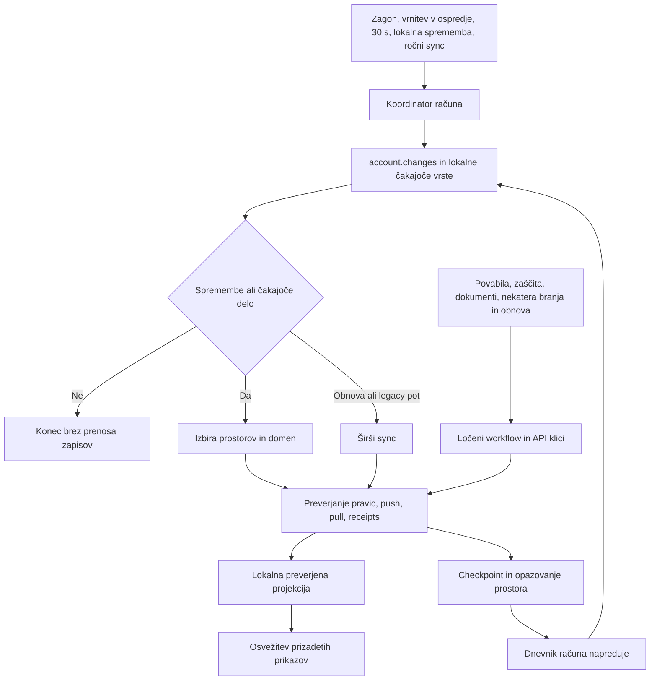

# Pregled poti sinhronizacije za prenovo aplikacije Jivie

Pregled delovne različice z dne 24. oktobra 2026. Izhodišče za nadaljnjo predelavo celotne aplikacije, vključno z opravili, projekti, dogodki, nakupi, financami, idejami, vrtom, dokumenti, deljenjem in obnovo.

Ta pregled ohranja stanje pred predelavo. Izvedba prvega koraka in njeni rezultati so ločeno zbrani v [ločitvi sprememb podatkov od potrjevanja sinhronizacije](/Users/anzenovsak/Git/kanban/docs/SYNC_SEMANTIC_HINTS_2026_10_24.md).

Naslednji izvedeni korak — skupni nadzor zahtevkov, oznake neposrednih opravil in prebujanje po trajnem lokalnem zapisu — je opisan v [poročilu koordinatorja](/Users/anzenovsak/Git/kanban/docs/SYNC_ACCOUNT_WORK_COORDINATOR_2026_10_24.md). Preostala čakanja pred lokalnim prikazom finančnega obrazca in dokumentov obravnava [tretji korak](/Users/anzenovsak/Git/kanban/docs/SYNC_LOCAL_FIRST_SCREENS_2026_10_24.md). Omejena ponovna uporaba začetne priprave in ciljni izbor podprtih čakajočih zapisov sta opisana v [naslednjem izvedbenem koraku](/Users/anzenovsak/Git/kanban/docs/SYNC_PHASE_REUSE_2026_10_24.md); dokument izrecno loči podprto podmnožico od preostalih širših poti. Spodnji inventar ostaja zgodovinsko izhodišče, ne opis stanja po teh popravkih.

**Koordinator in 30-sekundno preverjanje sprememb že obstajata, vendar še ne obvladujeta vseh omrežnih poti. Najpomembnejša odkrita povezava je, da napredovanje kriptografskega dnevnika računa lahko postane signal spremembe dostopa, ta pa izbere ponovno obdelavo vsebine in financ več prostorov.** Zato zgolj podaljšanje intervala ali večji predpomnilnik ne reši celotnega problema.

Naslednja predelava mora ločiti: kaj se je dejansko spremenilo, katero preverjanje je potrebno, katera opravila že tečejo in katere lokalne prikaze je treba osvežiti. E2EE, obstoječe avtorstvo, podatki in obnovljivost podpisanih zahtev ostanejo osnovne zahteve.

## Obseg in stanje izhodišča

Pregled zajema trenutno delovno drevo, **ne samo zadnjega commita** `a41cf9986fb1b9135c28fd768578f6b0a5264c4b`. Kontrolni posnetek vsebuje 911 datotek iz `lib`, strežniškega vtičnika in platformnih map, s skupnim SHA256 `7dbc0546bba10ff0637a5ce5de703b257388c7b343821ca42c0912e2f2466371`. Obstoječe spremembe prenove so bile prisotne pred tem pregledom.

To je izvorni pregled in analiza že shranjenih dokazov. Ne predstavlja novega testa hitrosti ali potrditve izdaje. Zadnji lokalni preizkus omejitve zahtevkov ostaja **STOP3**, brez četrte ponovitve. Telefoni, produkcija in podatki testnih okolij niso predmet posegov tega pregleda.

Podrobne inventarje poti vsebujejo priloge:

- [Zasloni, sprožilci in lokalne osvežitve](/Users/anzenovsak/Git/kanban/docs/audits/SYNC_PATHS_UI_2026_10_24.md).
- [Koordinator, repozitoriji in podatkovni moduli](/Users/anzenovsak/Git/kanban/docs/audits/SYNC_PATHS_CORE_2026_10_24.md).
- [Kriptografske poti in strežnik](/Users/anzenovsak/Git/kanban/docs/audits/SYNC_PATHS_CRYPTO_SERVER_2026_10_24.md).

Te priloge so inventar implementacijskih mest; nadaljnji načrt in prioritete so zbrani spodaj. Stare ugotovitve o počasnem odpiranju opravil se ne smejo samodejno pripisati sedanji kodi: del local-first prenove je že izveden.

## Kako trenutno potuje delo

Puščica iz dnevnika nazaj v preverjanje sprememb pomeni potrjeno povezavo v kodi, **ne dokazane neskončne zanke**. Za že znani checkpoint in opazovanje obstajajo varovala proti ponovnemu zapisovanju.

### Običajni koordinator

`syncNow` združuje sočasne zahteve v en tekoči postopek in ohrani zahtevo, ki prispe med izvajanjem, za naslednji prehod. `account.changes` izbere delo po računu, prostoru in domeni; lokalni outbox in ukazi dodajo delo, tudi kadar strežnik ne sporoči sprememb. Brez sprememb in čakajočega dela se prehod konča. Novi account cursor se potrdi šele po uspešnem zaključku prenosa in trajnih domenskih cursorjih. [Izvedba koordinatorja](/Users/anzenovsak/Git/kanban/lib/organizer/data/collaboration_sync_actions.dart:100).

Pri starem strežniku ostane celotna združljiva pot. Neveljaven cursor povzroči preverjeno ponovno pridobitev izhodišča. Čakajoči `crypto_outbox` ali določeno delo povezanih plačil izbere `changes: null`, torej širši sync. `syncNow(resumePayments: false)` vstopi neposredno v izvajalnik, mimo običajnega preverjanja sprememb. To so pomembne izjeme, ki jih naslednja arhitektura mora izrecno predstavljati, ne skriti za isto ime metode.

### Strežniški pregled sprememb

`account.changes` primerja trenutne prstne odtise metapodatkov s prejšnjim HMAC-overjenim cursorjem. Vrne seznam spremenjenih domen in prostorov; **ne vrne njihovih zapisov ali neposrednega seznama spremenjenih ID-jev zapisov**. Dejanske zapise nato prenesejo obstoječe preverjene inkrementalne poti. HMAC strežnika ni podpisan dokaz E2EE pravic. [Strežniška izvedba](/Users/anzenovsak/Git/kanban/server/plugins/FamilyHub/Model/NativeAccountChanges.php:100).

To je en HTTP zahtevek, vendar delo SQL ni neodvisno od števila prostorov in članstev. Pregled uporablja metapodatke, cursorje in zgoščevanje članstev, ne inventarja vsebinskih zapisov. Omejitve vključujejo največ 2048 prostorov in omejeno velikost cursorja. Oznaka »lahko preverjanje« zato pomeni manjši obseg podatkov, ne zagotovljene konstantne cene.

### Omrežne poti zunaj običajnega koordinatorja

Povabila in njihova odobritev, čarovnik zaščite, življenjski cikel prostora, dokumenti in priloge, določene finančne priprave ter obnova uporabljajo tudi neposredne workflow oziroma router klice. Normalni `_syncing` in crypto queue zato nista ena univerzalna ključavnica nad vsem prometom. Crypto `_exclusive` serializira operacije vrste, kot so staging, pull, dostava in receipts; ne vseh preverjanj imenika, pravic ali zaslonov.

Foreground odobritev povabila ob začetku preveri, da sync ne teče, vendar sama ne zasede običajnega koordinatorja za celotno delo. Pozneje sproženo preverjanje se zato lahko preplete z njo. To je možnost iz kode, ne časovno izmerjen dokaz prekrivanja v zadnjem neuspelem testu.

## Kaj pokažejo obstoječi zahtevki

V zadnjem zajetem oknu 75 sekund je bilo **949 HTTP zahtevkov: 946 uspešnih in 3 zavrnjeni z 429**. Od tega je bilo 924 zahtevkov `crypto2`, le pet pa `account.changes`. Največ prometa so predstavljala preverjanja kriptografskih metapodatkov:

| Operacija | Število |
| --- | ---: |
| `directory.status` | 286 |
| `scope.headGet` | 152 |
| `authority.snapshot` | 97 |
| `scope.lifecycle.list` | 66 |
| `domain.inventory` | 64 |
| `account.status` | 56 |
| `scope.lifecycle.baseline` | 47 |
| `records.pull` | 32 |
| `receipt.get` | 28 |
| `account.changes` | 5 |

Prvih šest prikazanih operacij je skupaj 721 zahtevkov. To usmerja preiskavo k obsegu in ponovni uporabi preverjanj. Ne pomeni, da je vseh 721 nepotrebnih. Prvi zavrnjeni crypto zahtevek je bil 601. po 600 uspešnih v strežniškem omejitvenem oknu. Interni podklici strežniškega `authority.snapshot` niso dodatni HTTP zahtevki v tem štetju.

Dnevnik ne vsebuje vzroka klica, identitete klientovega cikla in vsebine odgovora `account.changes`. Zato ne določa, kateri zaslon ali workflow je povzročil vsak zahtevek, niti koliko zahtevkov je povzročila spodnja razširitev sprememb. Prav tako to ni meritev mirujoče aplikacije ali primerljiv benchmark prejšnje različice. [Shranjeno štetje](/Users/anzenovsak/Git/kanban/build/qa/sync-redesign-20261024/r6-request-accounting.json).

## Ugotovitve za predelavo

### 1 Napredovanje dnevnika lahko sproži obdelavo vsebine in financ

Po preverjenem prenosu lahko klient objavi checkpoint in opazovanje prostora. Novo `scopeObserve` je podpisan dogodek v dnevniku računa. Pri njem se povečata `generation` in `head_hash`, čeprav se dovoljenja ali seznam naprav ne spremenijo.

Strežniški fingerprint članov vključuje prav ta dva stolpca. Njuna sprememba zato spremeni domeno `access` vseh vidnih prostorov, v katerih je vključena ta članska vrstica; upoštevajo se tudi metapodatki nadrejenega prostora. Klient pa `access` obravnava kot razlog za pregled vsebine **in** financ. Nastane veriga:

1. Prenos in novo potrjeno opazovanje prostora.
2. Nov dogodek v dnevniku računa.
3. Drugačen fingerprint dostopa na strežniku.
4. Naslednji probe izbere ponovno vsebinsko in finančno delo v več prostorih.

Dokazi: [opazovanje in preverjanje že znanega zapisa](/Users/anzenovsak/Git/kanban/lib/organizer/data/e2ee/crypto_scope_observations.dart:166), [obdelava scopeObserve](/Users/anzenovsak/Git/kanban/server/plugins/FamilyHub/Model/NativeCryptoDirectoryV2.php:135), [napredovanje imenika](/Users/anzenovsak/Git/kanban/server/plugins/FamilyHub/Model/NativeCryptoDirectoryV2.php:359), [fingerprint članstva](/Users/anzenovsak/Git/kanban/server/plugins/FamilyHub/Model/NativeAccountChanges.php:124), [izbira domen na klientu](/Users/anzenovsak/Git/kanban/lib/organizer/data/collaboration_account_changes.dart:14).

Poizvedba za ta fingerprint vključuje tudi ohranjene neaktivne članske vrstice, zato lahko dodatno razširi invalidacijo. To ne pomeni, da neaktiven član dobi dostop: začetna izbira vidnih prostorov in preverjanje avtorizacije sta ločena.

**Predelava:** ločiti signal spremembe dnevnika od semantične spremembe naprav, članstva, ključne epohe in dovoljenj. Napredovanje dnevnika mora še vedno sprožiti preverjanje ustreznih podpisanih dogodkov; šele preverjeni pomen dogodka določi druge odvisnosti. Samo odstranitev `directory` iz preverjanja ali slepo zaupanje strežniškemu namigu bi bila napačna rešitev.

`hasReusableCheckpoint` in zgodnja vrnitev ob že znanem `observationHash` omejujeta ponovno zapisovanje. Zato iz te verige ni upravičeno sklepati, da vsak prazen sync nujno ustvari naslednjega. [Checkpoint varovalo](/Users/anzenovsak/Git/kanban/lib/organizer/data/e2ee/crypto_domain_checkpoint_publisher.dart:15).

### 2 Koordinator nima pregleda nad vsem delom računa

Podobne osnovne podatke lahko zahtevajo sync, čarovnik zaščite, povabilo, člani prostora in dokumenti. Deljenje preverjenih podatkov je omejeno na posamezen kontekst; koordinacija običajnega synca ne prepreči vsakega prepletanja.

**Predelava:** eno mesto mora evidentirati omrežno delo računa z razlogom, ciljnim prostorom, domeno in odvisnostmi. Med seboj združljivo branje se združi; mutacije, obnova in prehod računa ohranijo izrecne meje. To ne pomeni ene dolge globalne blokade uporabniškega vmesnika ali samodejnega pošiljanja vseh poslovnih ukazov skozi isti full sync.

### 3 Kratko združevanje metapodatkov še ne pokriva celotnega prenosa

Sedanja skupina preverjenih branj pokriva `scopes.list` in `scopes.members`, znotraj istega računa, seje in izvirnega kratkega obdobja veljavnosti. Ne pokriva vsebinskega pulla, financ, outboxa ali postopka obnove. Iztek obdobja, napaka ali mutacija kontekst zaprejo; receipts se berejo sveže. [Meja združevanja](/Users/anzenovsak/Git/kanban/lib/organizer/data/e2ee/crypto_verified_dispatch_reads.dart).

**Predelava:** najprej popisati odvisnosti vsake faze, nato združevati identične preverjene selektorje znotraj te faze. Skupni ključ mora vključiti račun, napravo, prostor, domeno, glavo članstva in ustrezne revizije. Ne podaljševati petsekundne veljavnosti na slepo in ne uporabljati prejšnjega dokaza za nov zapis po mutaciji.

### 4 Obnovitveno delo se lahko razširi na celoten račun

Že en pending crypto zapis ali povezano plačilo lahko namesto ciljnega izbora uporabi širši sync. Če je težava dolgotrajna, je pomembno tudi, koliko neodvisnega dela se ob vsakem nadaljevanju ponovi. [Izbira obnovitvene poti](/Users/anzenovsak/Git/kanban/lib/organizer/data/collaboration_sync_actions.dart:263).

**Predelava:** obnovitveno delo naj ohrani identiteto in odvisnosti točne operacije: preveri receipt, nadaljuj podpisano zahtevo, osveži potreben scope. Celoten pregled naj ima izrecen razlog, na primer izgubljeno izhodišče ali nezdružljiv starejši strežnik. Konflikt ali čakanje enega zapisa ne sme ustaviti nepovezanih zapisov.

### 5 Branje lahko vključuje pripravo ali zapisovanje kriptografskih metapodatkov

Finančne izbire, projekcijski cursorji, katalog in obnovitveni pregledi niso vsi preprosta SQL branja. Preverjeni pull lahko vodi v objavo checkpointa; priprava izbir lahko potrebuje preverjene selektorje. To pojasni, zakaj poimenovanje `read`, `refresh` ali `ensure` samo po sebi ne pove cene ali stranskih učinkov.

**Predelava:** ločiti lokalni prikaz, omrežno preverjanje, materializacijo projekcije in potrjevanje obnovitvenega stanja. Lokalni prikaz ne sme mimogrede zahtevati poslovne mutacije. Potrebni dodatni koraki postanejo vidna opravila koordinatorja, ne odstranijo se njihova varovala.

### 6 Finance so ena od odvisnosti in niso edini problem

Opravilo s stroškom, ponavljajoča plačila in povezani stroški imajo resnične finančne odvisnosti. Navadno opravilo ali ideja jih praviloma nima. Razširitev `access` na finance in široki obnovitveni prehodi lahko oba primera obravnavajo preveč podobno.

**Predelava:** odvisnosti določiti po operaciji. Opravilo brez spremembe stroška ne sme izbrati finančne obdelave samo zato, ker je finančni modul v aplikaciji. Pri povezanem task/cost paru pa ostanejo skupna veljavnost, konflikt in idempotentna dostava. Enako jasno določiti posebnosti tabel, prilog, idejnih desk in vrta.

### 7 Omrežne in lokalne osvežitve potrebujejo ločeno sled

Sprememba lokalnega stanja lahko obvesti več providerjev in obnovi več prikazov, ne da bi nastal nov HTTP zahtevek. Obratno lahko en UI dogodek sproži več preverjanj v globini routerja. Časovniki za lokalno uro, prikaz, shranjevanje osnutka in dokumentne lease imajo različne namene.

Trenutna koda že omejuje del lokalnih osvežitev z domenskimi podpisi in ohranja nespremenjene projekcije. Ostajajo širši agregati ter nekateri klici `personalChanged()` brez domenskega filtra. Prav tako lokalni prikaz še ni povsod enak: obstoječi task editor se odpre pred finančnimi izbirami, finančni entry editor nanje še čaka, dokumentni gateway pa najprej poskusi oddaljeno branje. Odprtje planiranja in usklajevanje lokalnih obvestil lahko materializirata ponavljajoče vnose; to je poslovna sprememba, ne samo osvežitev prikaza. [Primerjava modulov in sprožilcev](/Users/anzenovsak/Git/kanban/docs/audits/SYNC_PATHS_UI_2026_10_24.md).

**Predelava:** meriti posebej mrežo, čakanje na zaklep, SQL, preverjanje podpisov, dešifriranje, projekcijo in risanje zaslona. Odstranitev lokalnega timerja brez te ločitve ni dokaz optimizacije. Pristine obrazec se lahko osveži z novo verzijo; dirty osnutek se ohrani z vidnim obvestilom o novejšem zapisu.

### 8 Vsi lokalni zapisi ne prebudijo koordinatorja enako

Takojšnjo zahtevo za samodejni sync odda `CollaborationController._edit`. Shranjevanje skupne ideje ali vrta pa lahko potuje skozi lasten controller in storage neposredno do repozitorijskega `_recordEdit`. Ta trajno shrani delo in osveži lokalno stanje, brez istega signala za takojšnji sync. Listener spremembe repozitorija objavi stanje, vendar sam ne nastavi zahteve za prenos. Naslednji načrtovani pregled lahko delo odkrije; dejanska zakasnitev ni izmerjena. [Signal controllerja](/Users/anzenovsak/Git/kanban/lib/organizer/state/collaboration_provider.dart:384), [listener](/Users/anzenovsak/Git/kanban/lib/organizer/state/collaboration_provider.dart:157), [zapis repozitorija](/Users/anzenovsak/Git/kanban/lib/organizer/data/collaboration_record_actions.dart:138).

**Predelava:** trajni nastanek novega outbox dela naj odda enoten signal ne glede na modul ali vstopni zaslon. Samo branje ali objava stanja tega signala ne sme oddati. S tem ločimo »nov zapis za pošiljanje« od »zaslon se je osvežil«.

Enaka vrzel je opisana tudi za povezane osebne vnose skozi organizer storage. Povsem lokalna uporaba brez računa seveda ne potrebuje omrežnega signala.

### 9 Strežniško branje ni vedno brez stranskih učinkov

Nekatere običajne crypto read poti osvežijo pretečene pending glave ali izvedene lifecycle oznake in sodelujejo v zaklepanju strežniške transakcije. `scopeObservation.put` je celo na transportnem read allowlistu, a shrani candidate observation; klient ga pravilno obravnava kot mutacijo. `authority.snapshot` ima drugačno, izrecno read-only mejo. [Podrobnosti in izvorne povezave](/Users/anzenovsak/Git/kanban/docs/audits/SYNC_PATHS_CRYPTO_SERVER_2026_10_24.md).

**Predelava:** razvrstitev za združevanje zahtevkov mora temeljiti na dejanskem obnašanju operacije. Ime endpointa ali oznaka read ne zadostujeta; poslovne mutacije in potrebno vzdrževanje stanja ne smejo izginiti v predpomnilniku.

## Pokritost celotne aplikacije

| Področje | Kaj mora predelava upoštevati |
| --- | --- |
| Račun, zagon, ospredje, ročni sync | En normalen probe na račun, združevanje zahtev, backoff, veljavnost seje, menjava računa. |
| Prostori in projekti | Katalog, člani, hierarhija, zasebni prostori, arhiviranje, brisanje, objava in selitev. Sprememba enega prostora ne pomeni spremembe vseh. |
| Opravila in dogodki | Lokalni prikaz in trajen osnutek, avtorstvo in dodeljeni uporabnik, konfliktnost posameznega zapisa, finančna odvisnost samo pri dejanskem strošku. |
| Nakupi | Posamezen element in checkbox, ločitev od preimenovanja, kaskadni izbris celote s tujimi vnosi samo za lastnika. |
| Finance | Računi, vnosi, kategorije, načrtovanje, ponavljanja, saldo, parent odvisnosti, task/cost par in povezano plačilo. |
| Ideje in vrt | Trenutna meja je pogosto celotna deska oziroma vrt; ločeni asseti, preprečevanje prepisovanja tujih sočasnih sprememb. |
| Tabele | Dokumentna revizija, lease, lokalni osnutek, objava in prekinitev; lease ni nadomestilo za dovoljenje. |
| Priloge | Prenos bajtov, manifest, dokončanje, hash, tombstone in obnova prekinitve so ločene faze. |
| Iskanje, Utrip in pregledi | Berejo projekcije. Posodobiti samo prizadete prikaze in ne obravnavati branja kot novega urejanja. |
| Povabila in deljenje | Pošiljanje, sprejem, samodejna odobritev v ospredju, čakanje na ključe, obvestilo in preklic; isti zahtevki in identitete ostanejo. |
| Inbox in opomniki | Prikaz, lokalni read/unread ukaz in oddaljena potrditev se ne smejo medsebojno prepisati. Push je sprožilec, ne dokaz dovoljenja. |
| Zaščita, migracija in obnova | Ločiti lokalno bazo, zaščito povezanega računa, obnovitev računa, portable backup in obnovo celotne namestitve. Te poti ne smejo ponoviti uspešne mutacije ali izgubiti pending zahtev. |

Podrobne vstopne točke, metode in poti do kode so v treh inventarjih na začetku dokumenta. Obstoječe avtorstvo se ohrani skozi migracijo in projekcijo; odsotnost polja v UI modelu ni dokaz, da avtorstva ni.

## Predlagana pogodba prenovljenega izvajanja

1. **Lokalni prikaz je takojšen.** Odprtje običajnega zapisa uporabi zadnjo preverjeno lokalno projekcijo. Shranjevanje potrdi trajni lokalni zapis in jasno pokaže stanje pošiljanja.
2. **Koordinator vodi seznam konkretnih opravil.** Vsako ima račun, prostor, domeno, razlog, odvisnosti, stanje in identiteto nadaljevanja. Podvojene zahteve se združijo; prioriteta ne zaobide varoval.
3. **Preverjanje sprememb ostane na 30 sekund v ospredju.** Ko ni sprememb, ni lokalne čakalne vrste in ni zapadle obnove, se ne začne domenski prenos. Firebase ostane za dejanska push obvestila.
4. **Namig izbere preverjanje, ne odobri dostopa.** Strežniška različica sprememb ne nadomesti podpisane glave, članstva ali dokazov. Po preverjenem directory dogodku se nadaljnje delo določi po njegovem pomenu.
5. **Prenos je ciljen.** Vsebina, finance, dokumenti, inbox in authority imajo ločene potrebe. Skupne preverjene odvisnosti se pridobijo enkrat v veljavni fazi.
6. **Mutacija ima jasno mejo svežine.** Pred dostavo se preverijo aktualna dovoljenja in pričakovana revizija. Sprememba glave, epoch ali računa razveljavi odvisne kontekste.
7. **Obnova nadaljuje točno operacijo.** Izgubljeni ACK najprej pomeni preverjanje točnega receipt, ne novo podpisovanje. Potrditev account sprememb in projekcijski cursor morata ostati vezana na uspešno trajno obdelavo. Transportni cursor je ločen: lahko označi že trajno prevzete vrstice, katerih semantična projekcija še čaka; tega ne smemo prikazati kot dokončano uskladitev.
8. **Konflikt je lokaliziran.** Neprekrivajoča polja se lahko združijo iz preverjene skupne osnove; nasprotujoče spremembe pokažejo jasno izbiro. Finančnih zneskov in poslovnih dejstev se ne sešteva samodejno.
9. **Pravice sledijo dogovoru.** Lastnik prostora ureja vse v njem, avtor svoje zapise, pri opravilih še dodeljeni uporabnik; checkbox nakupa vsi člani z dostopom. Skrbnik gostovanja ni lastnik zasebnih prostorov. Protokol mora uveljaviti pravilo, ne le skriti gumba.

Pri tem ohraniti trenutne ožje meje dodeljenega uporabnika: samo dodelitev mu ne daje pravice brisanja, spreminjanja dodelitev ali dodatnih finančnih pravic. Morebitna širitev teh pravic je ločena produktna odločitev.

To je predlog strukture izvedbe na podlagi pregleda. Samo ta dokument ne potrjuje, da so vsi koraki že implementirani ali preverjeni.

## Vrstni red nadaljnje predelave

| Faza | Konkreten rezultat | Pogoj za zaključek |
| --- | --- | --- |
| 1 Sled vzrokov | Zapis povezave sprožilec → opravilo → faza → zahtevek in lokalni strošek. | Iz enega neuspeha je razvidno, kdo je zahteval posamezno preverjanje in zakaj se je ponovilo. |
| 2 Pomen sprememb | Ločena obravnava napredovanja dnevnika, dejanskega dostopa, prikaznih metapodatkov in domenskih podatkov. | Novo opazovanje brez spremembe dovoljenj ne sproži nepotrebnega content/finance dela drugih prostorov. |
| 3 Pokritost koordinatorja | Evidentirana neposredna dela za povabila, zaščito, dokumente in obnovo; združene odvisnosti. | Noben neposredni obhod ni neimenovana konkurenca običajnemu syncu. |
| 4 Preverjene faze in ciljno nadaljevanje | Ponovna uporaba istih dokazov znotraj faze; konkretna obnovitvena opravila namesto neutemeljenih full prehodov. | Svežina in podpisi ostanejo, število zahtevkov sledi dejansko potrebnim odvisnostim. |
| 5 Prikazi in sporočila | Ciljne lokalne osvežitve, ohranjeni osnutki, razumljiva stanja in konflikti. | Odpiranje in lokalno shranjevanje ne čakata na nepovezano omrežno delo. |
| 6 En omejen lokalni scenarij | Nadaljevanje obstoječih nepreverjenih delov z merjenjem in jasnim budgetom. | Poročilo loči PASS, napake aplikacije, napake fixture in preskočene korake. |

Ne povečevati rate limita kot nadomestilo za to predelavo. Delo računskih metapodatkov ima lahko utemeljene omejitve, vendar najprej potrebujemo vzrok in ciljni obseg zahtevkov.

## Diagnostika in merila za naslednji lokalni preizkus

Diagnostični zapis naj vsebuje ID cikla in opravila, psevdonim računa/naprave, sprožilec, prostor/domeno, operacijo, razlog za full fallback, cache hit/miss in razlog invalidacije, čas čakanja ter trajanje faze. Pri `account.changes` potrebujemo imena spremenjenih domen in vezavo na prejšnji/novi cursor prek hasha. Ne zapisovati gesel, tokenov, ključev, obnovitvenih datotek ali dešifrirane vsebine uporabnikov.

Merila so konkretna, končno številčno omejitev crypto zahtevkov pa določimo iz odvisnosti, ne z ugibanjem:

- Mirujoč pripravljen račun brez pending dela: en načrtovani probe na 30 sekund, nič domenskih pullov ali novih checkpointov brez spremembe. Izrecno zabeležiti izjeme, kot je zapadla obnova seje.
- En navaden task update: prenos prizadetega zapisa in nujnih dokazov; nič nepovezanih finančnih pregledov ali zasebnih prostorov drugega uporabnika.
- Nov directory dogodek za opazovanje: preverjen dnevnik brez razširitve v neutemeljeno obdelavo vseh domen. Dejanski revoke/device change mora še vedno pravočasno omejiti nadaljnje dostave.
- Povabilo med aktivnim A: samodejna odobritev in sync si ne podvajata istega preverjanja; B lahko nadaljuje tudi pozneje, brez sočasne prisotnosti A.
- Prekinitev in izgubljeni ACK: ista podpisana zahteva, receipt-first, brez podvojenih poslovnih zapisov in brez preskoka cursorja.
- Pending konflikt ali nedostopen posamezen scope: ostalo delo napreduje, osnutek ostane, ni neomejenega hitrega retryja.
- Tabela in priloga: ohranjene lease/manifest meje in bajti; prekinjen upload se ne prikazuje kot dokončan dokument.
- Lokalni prikaz in shranjevanje: ločeno izmeriti čas UI, SQL in kriptografije. Uporabniško poročilo o 20 sekundah ni nadomestilo za sedanjo meritev posamezne faze.

Uspešnih prejšnjih scenarijev ne ponavljati rutinsko. Novo spremenjeno varovalo preveriti z ozko regresijo; nadaljevati samo odprte integracijske korake. Ob tretjem neuspešnem poskusu iste težave ohraniti dokaze in stanje, test označiti ter nadaljevati neodvisne korake.

## Odprte meje pred mobilnim nadaljevanjem

Odprti ostajajo preveliko število zahtevkov, točen vzrok začetne generične napake čarovnika B, manjkajoča vsebina nekaterih novih mobilnih/lokalnih scenarijev ter že dokumentirane meje centralne nadgradnje starih prostorov, eksplicitne obnove in selitve. Ime prenesenega projekta ni dokaz uspešnega prenosa njegovega opravila. Ta audit ne spreminja njihovih prejšnjih rezultatov.

Stanje in izvirni dokazi: [poročilo implementacije](/Users/anzenovsak/Git/kanban/docs/SYNC_REDESIGN_IMPLEMENTATION_2026_10_24.md), [ledger lokalnih scenarijev](/Users/anzenovsak/Git/kanban/build/qa/sync-redesign-20261024/native-scenario-ledger.json), [zaključek r6](/Users/anzenovsak/Git/kanban/build/qa/sync-redesign-20261024/r6-continuation-final.json). Mobilno nadaljevanje naj sledi odpravi in omejenemu lokalnemu dokazu konkretnih napak; obstoječih podatkov in povabila ni treba ustvarjati na novo.
